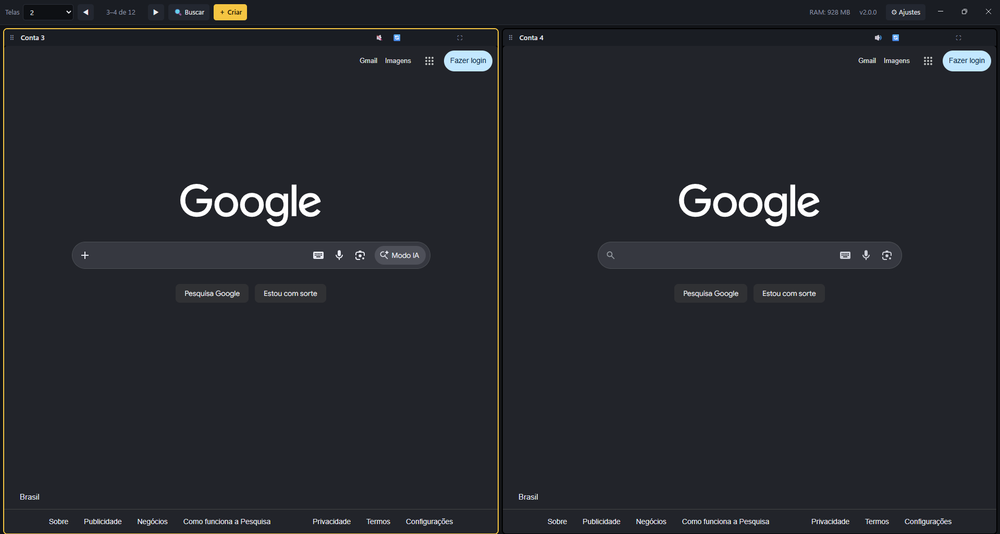

# Quad Idle

Várias contas de jogos *idle* em uma só janela, cada uma com login separado.



## O que faz

- **Contas isoladas:** cada conta tem a própria sessão (cookies e login separados), como se fossem navegadores diferentes.
- **Grade flexível:** mostra 1, 2, 4, 6 ou mais contas ao mesmo tempo, com paginação quando há mais contas do que cabem na tela.
- **Economia de RAM:** contas fora da tela podem ficar suspensas, e o app avisa quando a memória passa do limite que você definiu.
- **Sessões longas:** recria o jogo a cada N horas para evitar acúmulo de memória.
- **Controles por conta:** silenciar, zoom e tela cheia. Arraste o cabeçalho de um painel para reordenar.
- **No dia a dia:** bandeja do sistema, sempre no topo, impedir suspensão do PC e iniciar com o Windows.
- **Atualização automática** pelas Releases do GitHub.

O app não automatiza nada dentro dos jogos: ele só abre as páginas em janelas isoladas.

## Instalação

Windows 10 ou 11. Baixe o instalador `.exe` mais recente em [Releases](https://github.com/ReardDev/quad-idle/releases/latest) e execute.

O instalador não é assinado digitalmente, então o Windows SmartScreen pode avisar "o Windows protegeu o computador". Clique em **Mais informações** e depois em **Executar assim mesmo**.

## Atalhos

| Atalho | Ação |
| --- | --- |
| `Ctrl` + `1` a `9` | Ir para a conta de número 1 a 9 |
| `Ctrl` + `K` | Buscar uma conta pelo nome ou número |
| `Esc` | Sair da tela cheia |
| Duplo clique no cabeçalho do painel | Tela cheia |

Os atalhos funcionam mesmo com o foco dentro do jogo.

## Onde ficam os dados

Tudo fica no seu computador, em `%APPDATA%\Quad Idle`:

- `config.json`: suas contas e ajustes
- `quad-idle.log`: log, útil para reportar problemas (botão "Mostrar o log" nos Ajustes)
- `Partitions/`: logins salvos de cada conta

Nada é enviado para servidores. A única conexão do próprio app é a checagem de atualização no GitHub.

## Desenvolvimento

Requisitos: Node.js 22.12 ou mais novo.

```bash
npm ci
npm run dev
```

Outros comandos:

| Comando | O que faz |
| --- | --- |
| `npm run build` | Gera o instalador do Windows em `dist/` |
| `npm run typecheck` | Checa os tipos (processo principal e interface) |
| `npm run lint` | ESLint |
| `npm test` | Testes (Vitest) |
| `npm run format` | Prettier |

Estrutura:

```
src/main       processo principal do Electron (janelas, sessões, atualização)
src/preload    ponte segura entre o processo principal e a interface
src/renderer   interface em React + Tailwind
src/shared     tipos e funções usadas pelos dois lados
```

Para publicar uma versão: aumente o `version` no `package.json`, defina a variável de ambiente `GH_TOKEN` com um token do GitHub e rode `npm run publish`.

## Aviso

Alguns jogos limitam o número de contas por pessoa ou por rede. Seguir os termos de cada jogo é responsabilidade de quem usa. Este projeto não é afiliado a nenhum jogo.

## Licença

MIT. Veja o arquivo [LICENSE](LICENSE).
